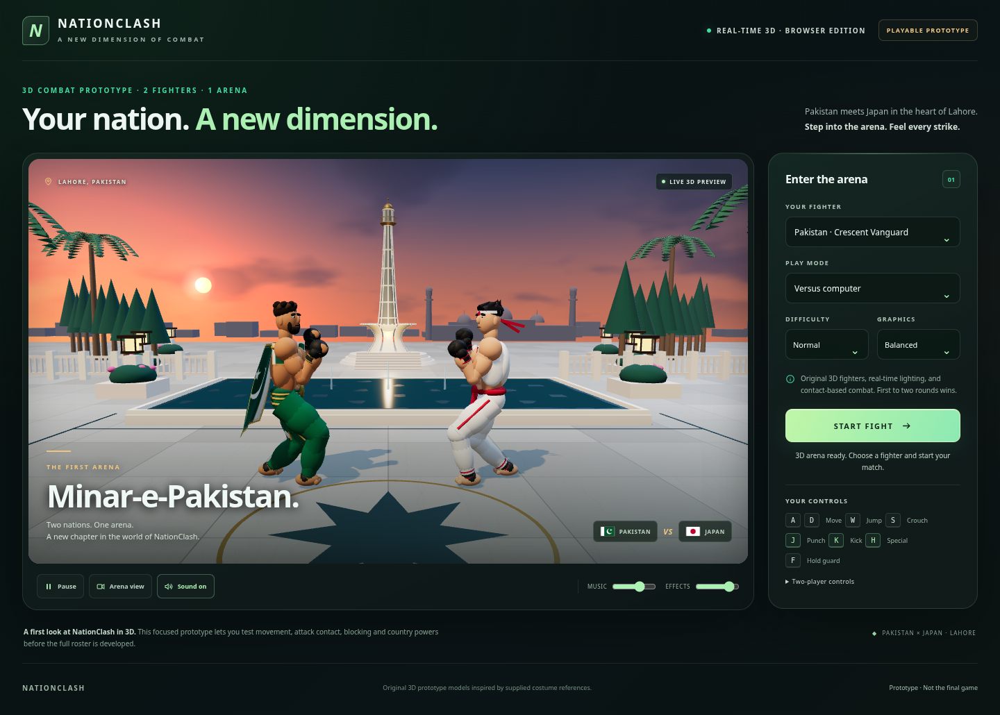
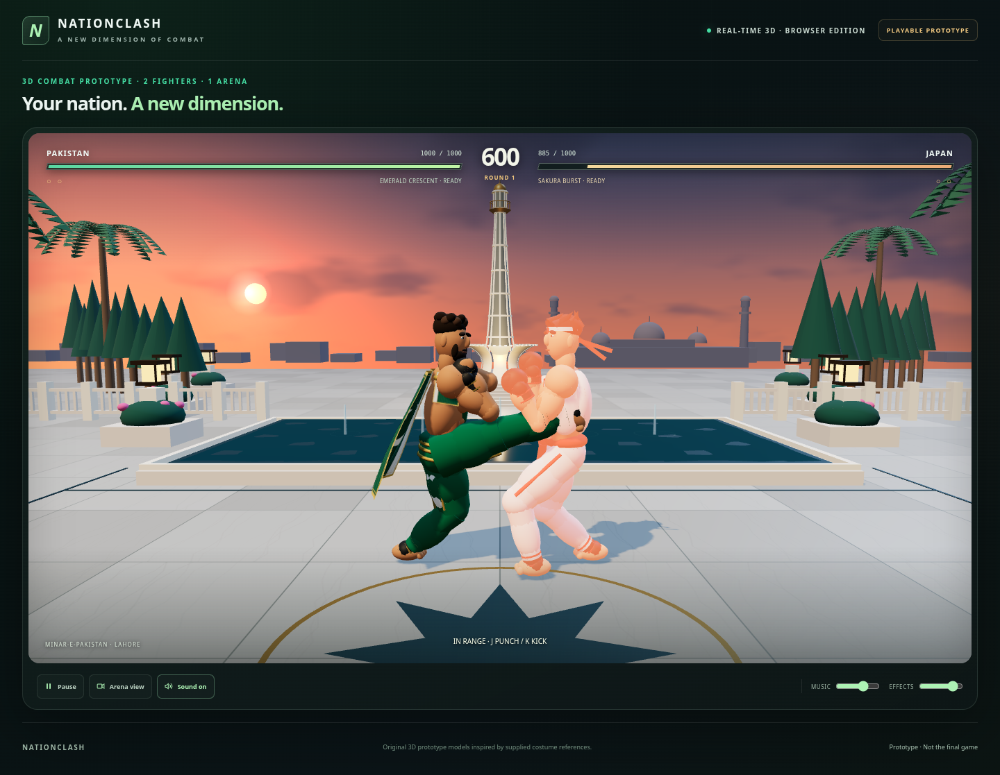

# 3D prototype validation — 16 October 2026

Pakistan and Japan fight at an original modelled Minar-e-Pakistan arena. The
prototype uses actual articulated meshes, perspective, 3D lighting and shadows.
Models are stylized costume-reference interpretations, with continuous joint
poses; they are not exact reconstructions of the supplied PNG artwork.

## Exact tested package

- ZIP: 323,576 bytes; SHA-256 `2c8d11e7cd900f282fc4161c5a0d2567eeadc2c2f2ad9c5ec5129af71585b97e`.
- HTML: 1,070,548 bytes; SHA-256 `ef0215dec776ccbe6cfa027fbc8167dfacbab3b27a7de544e5efe631d7fc1409`.
- Three ZIP members: one self-contained HTML, instructions and the Three.js MIT license.
- No external asset or script requests, companion files, server, account or Unity installation.
- All six bundled source files, embedded announcer clips, template and license verified.

## Executed checks

**101 repository tests pass**: 20 new 3D combat groups and 81 existing browser-game
unit groups. No failures or skips. Prototype tests exercise startup/recovery,
exactly one hit per strike, real range whiffs, actual joint contact coordinates,
mirrored attacks, head/body/thigh/shin capsules, low attacks and both guard types,
airborne targets, jump/landing, stage bounds including immediate wall separation,
cooldown, powers/interruption, swept collision, locked KO outcomes and finished
post-KO landing/recovery/flash.

**13 actual WebGL browser groups pass**, with zero runtime errors and external
network requests. The tested downloaded HTML is byte-identical to the ZIP's HTML:

- Actual perspective renderer, two volumetric mesh rigs with no fighter sprites,
  and a modelled landmark with measured geometry bounds.
- Both countries and both directions: eight independently measured fist/foot
  mesh world points agree with the combat contact coordinates to within 1e-6.
- Four travelling national powers: visible core position/radius follows its
  simulated collider and moves in the correct direction before contact.
- Real J and Numpad2 inputs, one punch/kick hit, recoil and health change.
- Pause freezes the clock and rig poses; resume advances the real render loop.
- Deciding keyboard KO finishes recovery/flash/landing with the outcome locked;
  rematch restores health and scores.
- Selecting Japan swaps actual rigs/powers; the live computer closes in and attacks.
- Sound, music and effect controls; portrait touch punch, target sizes and no
  horizontal overflow; landscape fight and controls fit side by side.

**96 / 96 full AI matches complete**, covering both country/slot arrangements,
three difficulties and 16 seeds. There are 271,674 finite-state step
checks. This samples the shared combat system; it is not a balance certification.
The audit source hash equals the combat module embedded in the tested HTML.

[Package/source hashes](3D-PROTOTYPE-PACKAGE.json) ·
[Browser evidence](3D-PROTOTYPE-BROWSER.json) ·
[Automated output](3D-PROTOTYPE-TESTS.txt) ·
[Full AI results](3D-PROTOTYPE-AI-AUDIT.json)

## Visual review and practical limits

Desktop menu, actual punch/kick contact, landmark framing and both touch layouts
were rendered and reviewed. The camera moves closer during contact while the
scaled, proportion-preserving landmark remains visible. Low graphics disables
shadows and lowers resolution for slower devices.

Testing used managed Linux Chromium with actual WebGL via CPU SwiftShader.
Its sampled desktop counter was about 15 FPS; this is not a hardware-GPU or
Android benchmark. Windows direct-file opening and native Android/Play Store
packaging have not been observed here. Current Chrome or Edge with WebGL/hardware
acceleration is recommended. This is a first 3D gameplay prototype, with two
fighters and one arena; final character art and device performance need further
iteration before a full roster or commercial release.





## Reproduce

```sh
python3 tools/build-prototype3d.py
python3 tools/verify-prototype3d.py
node --test Tests/Browser/*.test.cjs
node tools/audit-prototype3d.cjs
NATIONCLASH_3D_HTML=downloads/NationClash-3D-Prototype.html \
NATIONCLASH_3D_ARTIFACT_DIR=artifacts/prototype3d/verified-browser \
  node Tests/Browser/prototype3d-browser.cjs
```

## Verified public download

[Download the tested prototype ZIP](https://raw.githubusercontent.com/hague143/nations-clash/39a8e002ab32da310689171e4788f5b965aa0cc9/downloads/NationClash-3D-Prototype.zip).

The public ZIP returned HTTP 200. A full download passed the expected size,
SHA-256 and all CRC checks. Its HTML is byte-identical to the exact browser-tested
document. [Verification record](3D-PROTOTYPE-PUBLIC.json).
