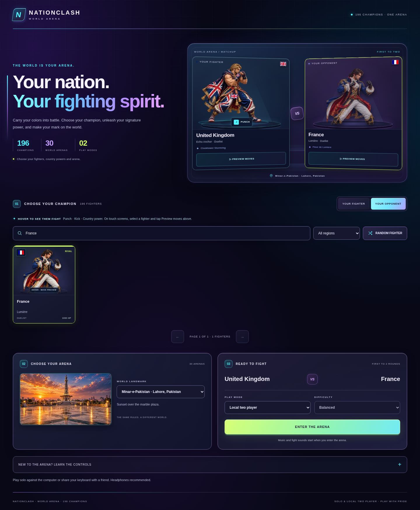
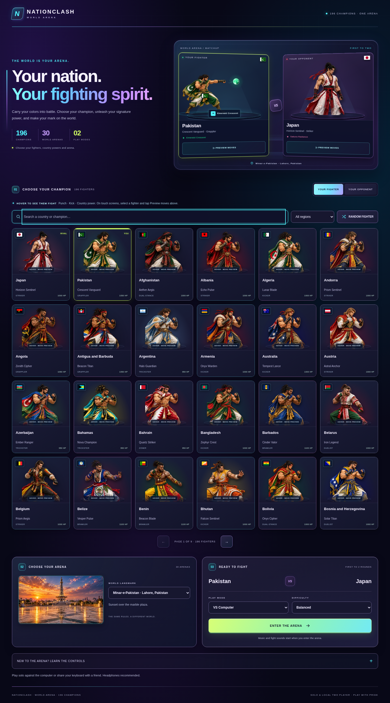

# Neon landing and fighter move previews

The entire landing page uses cyan, violet and lime lighting over an indigo
background: the brand, matchup, roster, search, arena selection and match setup.
Country costumes and official flags retain their supplied colors.

Hover a country card or either large matchup panel to cycle through **punch,
kick and that country's named signature power**. Keyboard focus also starts a
preview. On touch screens, select a fighter and tap **Preview moves** on its
matchup panel. This explicit button plays one cycle. Hover never selects a
different country or starts a fight. Leaving the portrait, filtering/paging,
scrolling it offscreen, switching tabs and entering a match stop the preview.

With reduced motion enabled, automatic previews show a still contact pose.
The explicit button lets the player request one demonstration cycle.

## Shared artwork and move definitions

`fighter-preview.js` reads `NationCombat.getMoveSpec` for light, heavy and
signature, then draws with the same `NationCountrySprites.draw` and
`NationPowerFX` functions as the game. The demonstration runs at 70% speed to
make startup, contact and recovery readable. It uses the assigned supplied
sheet's actual pose and the country's own projectile material, name and color.
Framing includes idle, block and all three strikes, with space for the power's
initial travel. The preview preserves the artwork's aspect ratio.

Previews use an isolated actor and assets, never `Fight.step`, health changes,
combat input or audio events. One canvas is reused. Pointer hover waits 140ms
before loading, superseded requests are skipped, and at most one atlas decode
runs at a time. The shared decoded cache retains at most six entries. A match
commits its own two atlas references only after its loading transaction is
current, so preview eviction cannot make old match images accumulate or replace
the artwork of a newer match.

## Browser acceptance

The focused runner checks the actual built or packaged document:

```sh
NATIONCLASH_HTML=artifacts/neon-landing/package-final/NationClash.html \
NATIONCLASH_ARTIFACT_DIR=artifacts/neon-landing/preview \
  node Tests/Browser/landing-preview.cjs
```

Its fixtures cover all 196 countries' punch, kick and signature contact poses
(588 cases), exact authored source indices, power ownership and launch geometry,
natural mouse and keyboard playback, touch controls, reduced motion, rapid
country changes, hidden/tiny/offscreen hosts, selection isolation, and match
atlas retention. Visual checks also ensure the static portrait disappears while
the actual animated fighter is displayed.

See [focused browser evidence](LANDING-PREVIEW-ACCEPTANCE.json),
[all 588 country preview fixtures](FIGHTER-PREVIEW-FIXTURES.json), and the
[download validation](DOWNLOAD-VALIDATION.md) for the exact artifact hashes,
executed gameplay checks and public download verification.

All **nine focused browser groups pass** on the exact downloadable HTML, with
zero runtime errors and external network requests. The 81 automated tests and
29 existing gameplay/presentation groups also pass, plus three loading and
navigation regression cases.




